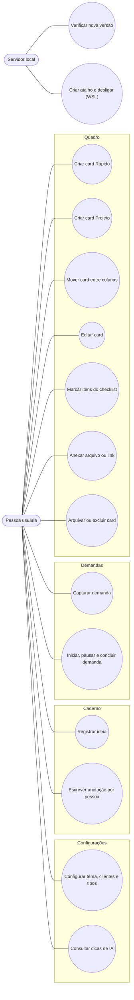
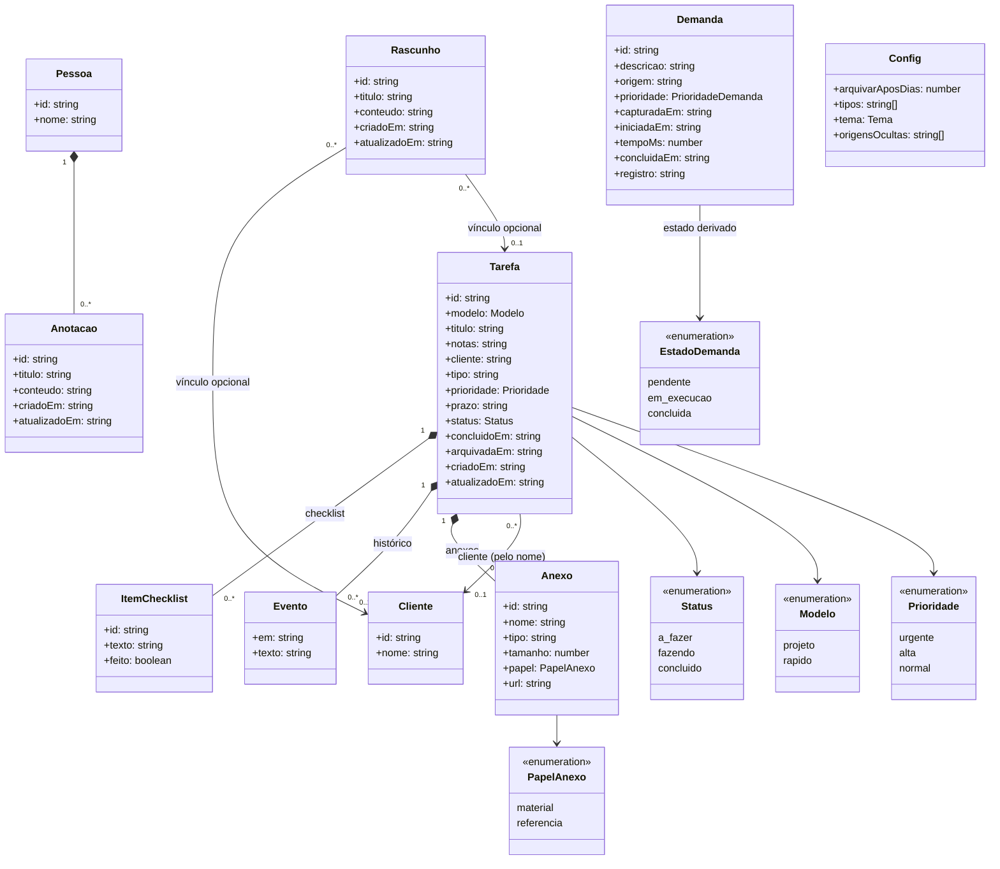
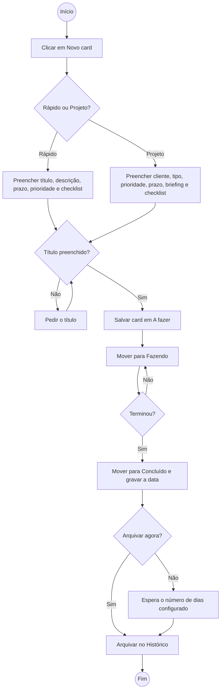
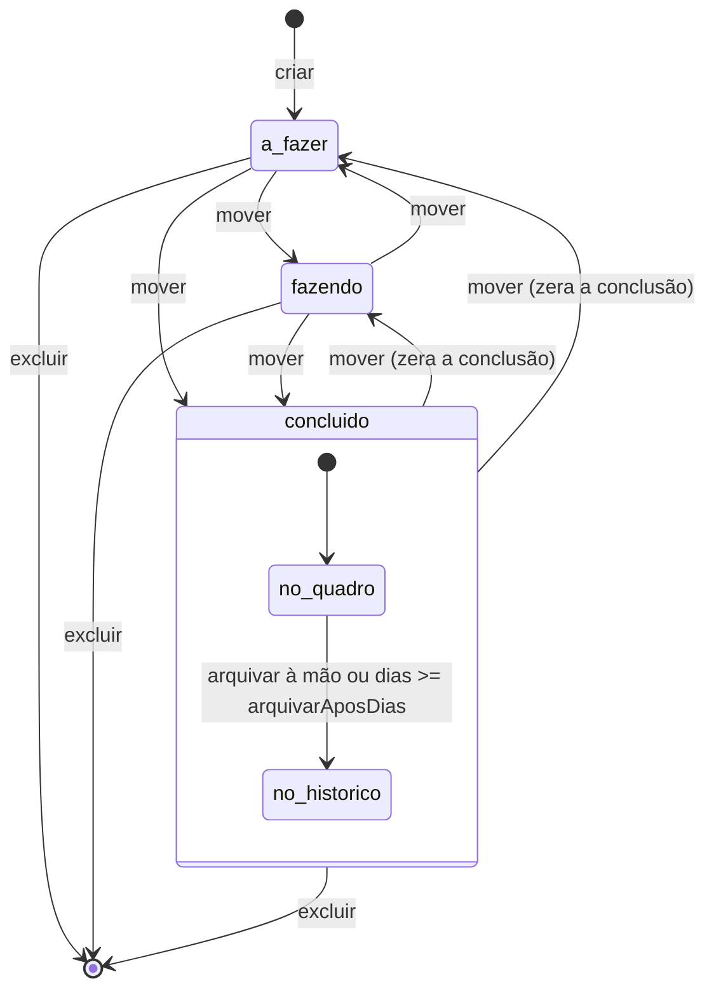
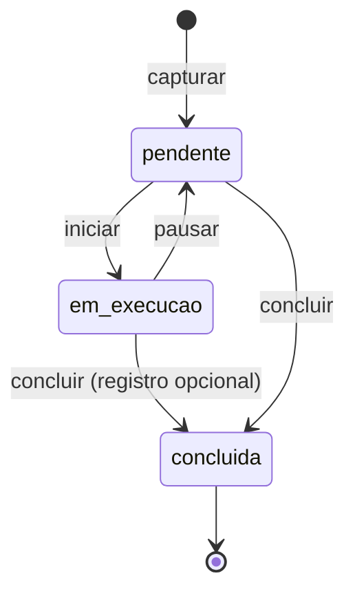

# Diagramas UML do DONELY

Os diagramas são escritos em Mermaid, então o GitHub e a maioria dos editores Markdown os desenham direto do texto. Eles descrevem o código atual: `app/src/shared/dominio.ts` (regras e tipos) e `app/src/server/repositorio.ts` (operações).

1. [Caso de uso](#1-caso-de-uso)
2. [Classes](#2-classes)
3. [Atividades](#3-atividades)
4. [Estados](#4-estados)

---

## 1. Caso de uso

Quem usa o app é uma só pessoa, então há um único ator. O servidor local aparece como ator secundário, para as ações que dependem do sistema operacional.

Pontos de leitura:

- "Editar card" cobre os dois modelos. O card Rápido não tem cliente, e o servidor descarta esse campo ao salvar (`SO_PROJETO` em `repositorio.ts`).
- Cada item do checklist é marcado ou editado sem abrir o card inteiro.

---

## 2. Classes

Diagrama de classes do domínio, com os tipos de `dominio.ts`. Os métodos ficam fora porque as operações estão no repositório, não nos tipos.

Pontos de leitura:

- `Tarefa.cliente` guarda o nome, não um identificador. Por isso a associação com `Cliente` é pelo nome, e renomear um cliente não atualiza os cards.
- `Demanda` não tem campo de estado: `estadoDemanda()` deriva o estado de `iniciadaEm` e `concluidaEm`.

---

## 3. Atividades

Fluxo de uma tarefa, do cadastro até o Histórico. Excluir é possível em qualquer etapa e não aparece aqui.

Pontos de leitura:

- O arquivamento automático não é uma ação: o card sai do quadro quando `dias >= arquivarAposDias` (`estaArquivada` em `dominio.ts`).
- Mover para uma coluna que não seja Concluído limpa a data de conclusão. Por isso o card volta a contar como aberto.

---

## 4. Estados

### 4.1 Tarefa

O status é um dos três valores de `Status`. O arquivamento é uma condição sobre o estado Concluído, não um valor gravado no status.

### 4.2 Demanda

O estado de uma demanda não planejada sai das datas `iniciadaEm` e `concluidaEm`. Só uma demanda pode estar em execução por vez: iniciar outra pausa a que estava rodando.

Depois de concluída, a demanda ainda aceita um registro escrito ou corrigido (`registrarDemanda`). Esse caso não muda o estado, então não aparece como transição.
