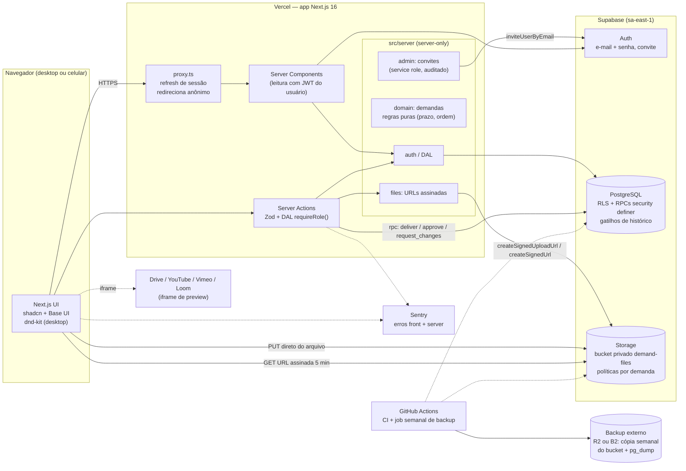
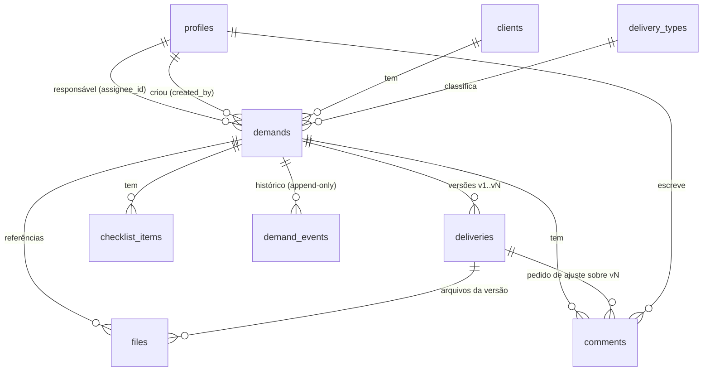
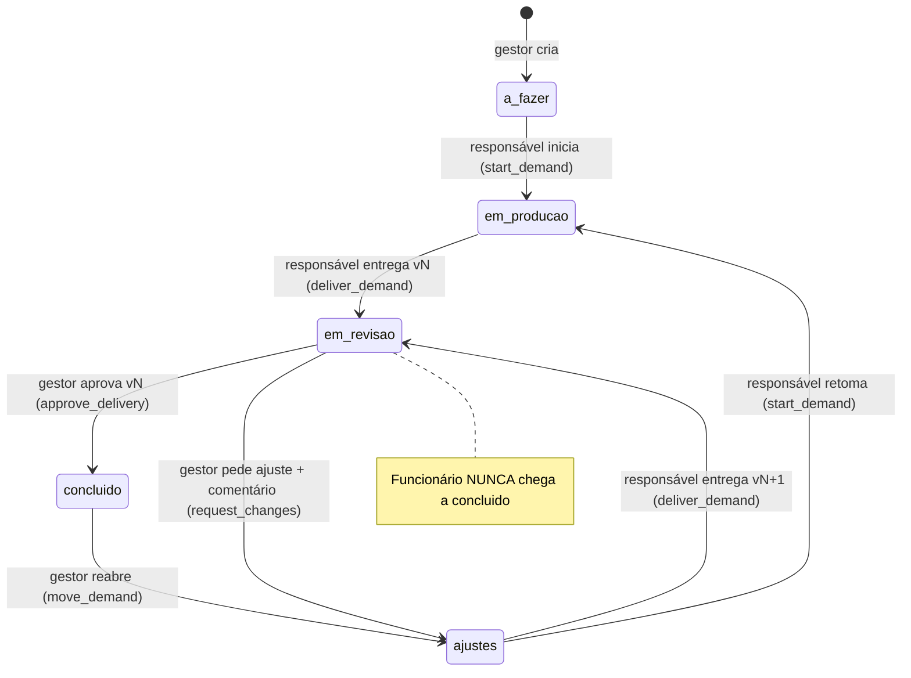
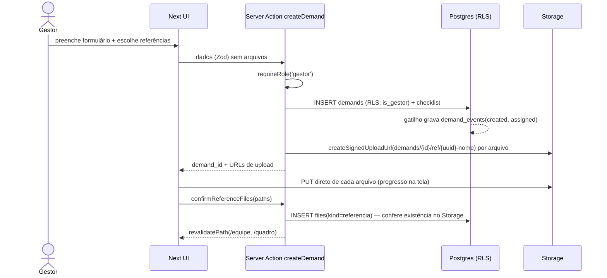
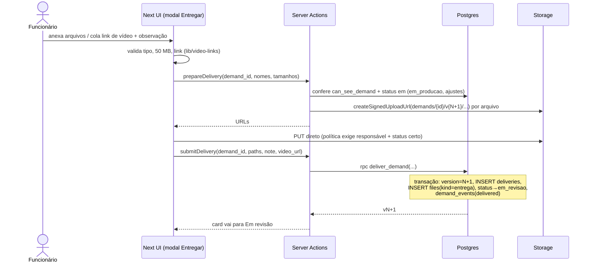
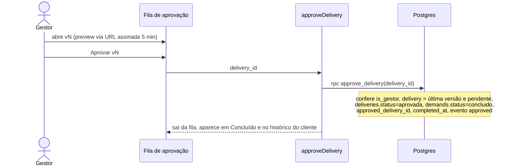
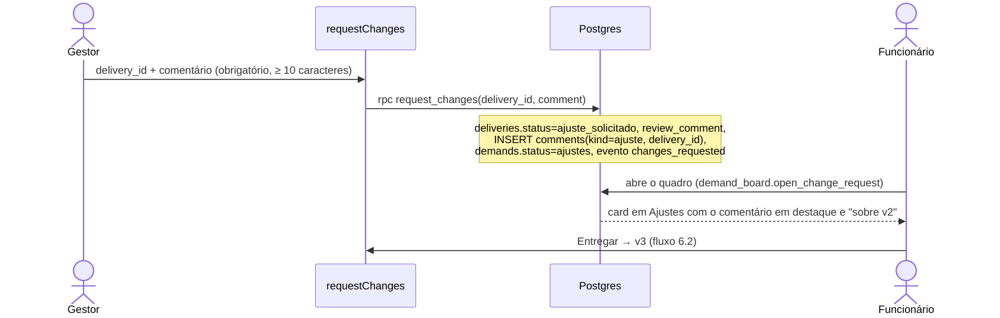

# Plano — WRMax Demandas (kanban interno)

## Tarefa atual: ajustes do protótipo (v3)

O protótipo navegável já está publicado em https://claude.ai/artifact/N5Wy8ny3kbxa5hg9upgWt3.
Ao aprovar, edito o arquivo `scratchpad/prototipo/src.html`, rodo a checagem de sintaxe e a
simulação de renderização de todas as telas, e republico no mesmo link. O documento de
arquitetura abaixo **não muda** agora; ele será revisado depois, a pedido.

| # | Pedido | Como fica |
|---|---|---|
| 1 | Priorizar o tema claro | O claro passa a ser o padrão ao abrir, sem depender do aparelho. Escuro e Automático continuam disponíveis nas configurações |
| 2 | Menu do usuário com configurações | Clicar no nome abre um menu: **Configurações**, Trocar de perfil (protótipo) e Sair. As configurações abrem um modal com: **foto de perfil** (enviar, trocar ou remover; a imagem é recortada em quadrado e reduzida, e aparece em todos os avatares); **tema** (Claro, Escuro ou Automático); **tom do escuro**, com 4 opções e amostras: Quente (padrão WRMax), Neutro, Profundo (preto puro, bom para OLED) e Suave (escuro mais claro). Tudo é salvo por pessoa |
| 3 | Recolher a sidebar | Botão no topo da sidebar. Recolhida, ela vira uma faixa de ícones (72 px) com o nome no `title`. O estado é lembrado |
| 4 | Aprovações sem selos | Saem os chips de tipo, prioridade, prazo e freelancer. Ficam cliente · código, título, quem entregou e quando, a observação, as prévias e os botões |
| 5 | Prioridade no modal do card | Só uma bolinha maior (12 px) na cor da prioridade, com o nome em `title` e `aria-label` para leitores de tela. Isso vale só no modal; o card do quadro continua com bolinha + nome |
| 6 | Recolher o histórico no modal | Setinha no título "Histórico", que abre e fecha. Começa aberto, e o estado é lembrado entre cards |
| 7 | Detalhes do painel sem métricas | Saem as barras "Por cliente / Por pessoa". Fica só a lista de demandas, com cliente e pessoas em cada linha |
| 8 | Histórico: busca, pessoas e datas | A busca vai para a **esquerda**, como primeiro campo, e passa a encontrar título, cliente **e nome da pessoa**. Novo seletor **Pessoa**, com todos os cadastrados agrupados em Equipe interna e Freelancers. As datas saem da linha e ficam atrás de um **botão com ícone de calendário**, que abre um painel com De/Até e os atalhos 30 dias, 90 dias e Tudo; quando há período ativo, o botão mostra o intervalo (ex.: "01/09 – 16/10"). A origem (Equipe interna / Freelancers) continua |
| 9 | Ligar o onboarding a Cadastros → Clientes | O onboarding é o app "Central do Cliente" (`onboarding.wrmaxmarketing.com.br`, painel do gestor em `/admin`). Em Cadastros → Clientes entram: o botão **"Cadastrar pelo onboarding"**, que abre `/admin` numa nova aba; e, em cada cliente, o **status do onboarding** (Concluído, Em andamento, Não iniciado) com o link "Abrir no onboarding". No protótipo, os status são fictícios. No sistema real, os dois apps leem o mesmo cadastro de clientes, ou o Demandas consulta o onboarding (a decidir quando revisarmos o plano, porque é uma integração entre dois projetos Supabase) |

**Verificação:** checagem de sintaxe do script (`node --check`) e a simulação que renderiza todas
as telas, os modais e os perfis com um DOM falso, incluindo o novo modal de configurações e o
painel do calendário. Depois, republicar no mesmo link.

---

## Contexto

A WRMax quer um kanban interno para tirar o fluxo de demandas do Notion. Cada pessoa deve
saber, ao entrar, para qual cliente é cada demanda, qual o prazo, o que é prioridade, o que já
concluiu e onde anexar a entrega. O ponto de partida analisado foi o Donko
(github.com/HigorLoren/donko): um protótipo em CRA, só frontend, sem backend nem persistência e
com dependências de 2022. **Decisão: reescrever**, usando o Donko só como referência visual.

Respostas que fecham o desenho (15/10/2026):

| Pergunta | Resposta |
|---|---|
| Documentos de entrada | `docs/DIAGNOSTICO.md` e `docs/AUDITORIA-UI.md` **não existem**. O diagnóstico usado é a análise do Donko feita nesta conversa; a auditoria de UI fica como premissa |
| Código antigo | Reescrever |
| Escala | ~10 usuários hoje, 25 em 2 anos, ~150 demandas/mês |
| Notion | **Substitui** (fonte única de verdade) |
| Responsável por demanda | **Um só**. Trabalho em dupla vira duas demandas |
| Gestores | **Vários**, todos veem tudo. O gestor também pode ser responsável |
| Login | **E-mail + senha**, por convite do gestor |
| Importação do Notion | Sem preferência → padrão: **importar só as abertas** (fase P, opcional) |
| Equipe | **Você + 1 dev, os dois fullstack.** A divisão é por fatia vertical, não por camada (§12) |
| Custos no desenvolvimento | **MVP em Supabase Free + Vercel Hobby** para testes. Planos pagos só no go-live (§9.0 e §12.4) |
| Foco do documento | **Roadmap e dia a dia da dupla:** fases, divisão de tarefas, branches, quem aprova o quê e como não atropelar o outro (§12) |

**O que será feito ao sair do modo de plano:** criar `/home/bryan/projects/wrmax/docs/PLANO.md`
(o caminho literal do pedido, ainda sem repositório) com o conteúdo da seção "Documento"
abaixo, sem alterar mais nada. Quando o repositório novo (`wrmax-demandas`) for criado na Fase 0,
o arquivo vai para `wrmax-demandas/docs/PLANO.md`.

Padrões herdados de `wrmax-metrics` (mesma stack, já validados na casa):
- autorização em três camadas: proxy, DAL em `src/server/auth` e RLS;
- `import "server-only"` em todo `src/server/**`;
- Zod em toda Server Action;
- migrações SQL aplicadas pelo SQL Editor (dev → prod);
- teste de RLS em PGlite (`supabase/tests/rls_isolation.sql`);
- shadcn sobre Base UI, com os tokens do WRMax Design System;
- Vitest, Dependabot, gitleaks e checklist de segurança (`docs/seguranca.md`).

## Verificação do entregável

- O arquivo `docs/PLANO.md` existe e tem as 12 seções na ordem pedida, precedidas da lista de
  dúvidas e respostas.
- Os blocos Mermaid são válidos (renderizar no GitHub ou em mermaid.live).
- Os preços citam a fonte e a data da consulta (15/10/2026).

---

# Documento (conteúdo de docs/PLANO.md)

# WRMax Demandas — Plano de arquitetura e roadmap

Versão 1 · 15/10/2026 · Status: proposta para aprovação

## 0. Dúvidas que mudam o desenho, e como foram resolvidas

| # | Dúvida | Resposta | Impacto no desenho |
|---|---|---|---|
| 1 | Atualizar ou reescrever o Donko? | Reescrever | Repositório novo. Do Donko só fica a referência visual |
| 2 | Escala | 10 → 25 usuários; 150 demandas/mês | Um monólito com um banco atende com folga de ~10x |
| 3 | Relação com o Notion | Substitui | Sem integração contínua. Só uma importação única |
| 4 | Um ou vários responsáveis? | Um | `demands.assignee_id`, e a RLS fica numa comparação só |
| 5 | Papéis de gestor | Vários, todos veem tudo; gestor pode executar | Papel global `gestor`, sem escopo por cliente |
| 6 | Forma de login | E-mail + senha por convite | Supabase Auth com cadastro público desligado e política de senha |
| 7 | Importar do Notion? | Sem preferência → só as abertas | Script único na Fase 7 |

**Premissas que precisam de validação. Cada uma muda uma regra, mas não a arquitetura:**

- **P1. O prazo é uma data, sem hora**, no fuso `America/Sao_Paulo`. O selo é calculado assim:
  - "vence hoje" quando `due_date = hoje`;
  - "atrasado" quando `due_date < hoje` e o status é *A fazer*, *Em produção* ou *Ajustes*.
- **P2. Card em *Em revisão* não conta como atraso do funcionário**, porque a bola está com o
  gestor. O painel do gestor mostra esses casos à parte, em "aguardando aprovação há N dias".
- **P3. O gestor pode arquivar (cancelar) uma demanda.** Ela sai do quadro e fica no histórico.
- **P4. O checklist é criado pelo gestor**, e tanto o responsável quanto o gestor podem marcar
  os itens. O funcionário pode adicionar itens próprios.
- **P5. Comentários não podem ser editados nem apagados pelo autor** nesta versão: o histórico
  é auditável. Só o gestor pode ocultar um comentário.
- **P6. O funcionário também move cards sozinho entre as colunas permitidas:**
  - *A fazer* → *Em produção*;
  - *Ajustes* → *Em produção*.
  A ida para *Em revisão* acontece **só** pelo botão "Entregar".
- **P7. Não há auditoria de UI formal.** A UI segue o WRMax Design System (o mesmo do
  wrmax-metrics). O Donko serve de referência de interação: colunas horizontais e card com
  faixa de cor.

---

## 1. Requisitos identificados

### 1.1 Funcionais

**Autenticação e perfis**
- RF01. Login com e-mail e senha. Não há cadastro público: o gestor convida por e-mail.
- RF02. Dois perfis, `gestor` e `funcionario`. Após o login:
  - o funcionário cai em `/quadro` (só as próprias demandas);
  - o gestor cai em `/equipe`.
- RF03. Recuperação de senha por e-mail.
- RF04. O gestor desativa um usuário, que perde o acesso na hora. O histórico dele é mantido.

**Demandas (gestor)**
- RF05. Criar demanda com:
  - cliente, responsável, tipo de entrega e prioridade (Urgente, Alta, Normal);
  - prazo e briefing em texto rico simples (markdown);
  - arquivos de referência e itens de checklist.
- RF06. Editar, reatribuir e arquivar uma demanda. Toda mudança entra no histórico.
- RF07. Cadastros: clientes, funcionários (convite, papel, ativo) e tipos de entrega (ativo,
  ordem).

**Kanban**
- RF08. Colunas fixas: *A fazer* → *Em produção* → *Em revisão* → *Ajustes* → *Concluído*.
- RF09. O card mostra:
  - cliente e título;
  - tipo e prioridade;
  - prazo com selo (no prazo, vence hoje, atrasado);
  - indicador de versão (v2...), de comentários novos e de "ajuste pedido".
- RF10. Ordem padrão: atrasadas → prioridade (Urgente > Alta > Normal) → prazo crescente. Não
  há ordenação manual.
- RF11. O funcionário filtra por cliente. O gestor filtra por funcionário e por cliente, e o
  filtro fica na URL.
- RF12. Resumo no topo:
  - funcionário: atrasadas, vencem hoje e concluídas na semana;
  - gestor: os mesmos números para a equipe.
- RF13. Transições permitidas (máquina de estados no banco, §6.0). **O funcionário nunca leva
  um card para *Concluído*.**
- RF14. *Concluído* mostra só os últimos 14 dias. O restante vai para o histórico.

**Detalhe do card**
- RF15. Mostra:
  - briefing e arquivos de referência;
  - checklist e comentários;
  - versões entregues;
  - histórico (linha do tempo de eventos).
- RF16. O último pedido de ajuste aparece **em destaque** no topo do card enquanto ele estiver
  em *Ajustes*.

**Entrega e versões**
- RF17. Botão "Entregar", disponível em *Em produção* e *Ajustes*:
  - o funcionário anexa arquivos e/ou um link de vídeo e escreve uma observação;
  - nasce a versão vN e o card vai para *Em revisão*.
- RF18. Upload direto de PDF, DOCX, JPG e PNG, até **50 MB por arquivo** e até 20 arquivos por
  versão.
- RF19. Pré-visualização de imagem e PDF dentro do sistema. DOCX só baixa.
- RF20. Vídeo por link (Google Drive, YouTube não listado, Vimeo, Loom), com pré-visualização
  embutida no card e no detalhe.
- RF21. Uma versão entregue é **imutável**: não se edita nem se apaga.

**Aprovação (gestor)**
- RF22. Fila de aprovação: tudo em *Em revisão*, mais antigos primeiro, com a pré-visualização
  da versão.
- RF23. "Aprovar vN" move o card para *Concluído* e registra quem aprovou e quando.
- RF24. "Pedir ajuste em vN" exige um comentário e devolve o card para *Ajustes*, com o
  comentário em destaque.

**Painel e histórico (gestor)**
- RF25. O painel mostra:
  - atrasadas, vencendo nos próximos 7 dias e abertas por funcionário;
  - entregas por pessoa e por cliente no período;
  - número de versões que voltaram para ajuste (por pessoa e por cliente);
  - itens aguardando aprovação.
- RF26. Histórico por cliente: todas as demandas concluídas, com a versão aprovada e os
  arquivos, e busca por título.

**Fora do escopo:** notificações por e-mail ou WhatsApp, acesso de clientes, controle de horas,
app nativo, upload direto de vídeo (fase futura, §9.3) e sincronização com o Notion.

### 1.2 Não funcionais

| ID | Requisito | Meta |
|---|---|---|
| RNF01 | **Permissão no banco** | Toda regra de visibilidade e de transição é aplicada por RLS ou por funções SQL. A UI só esconde botões |
| RNF02 | Mobile | Usável num celular de 360 px: colunas viram abas e o "mover" é por menu, sem arrastar |
| RNF03 | Desempenho | Quadro com até 200 cards em menos de 1,5 s (LCP, 4G). Ações em menos de 500 ms no p95 |
| RNF04 | Disponibilidade | A dos provedores (Vercel e Supabase Pro). Sem SLA próprio; uso só em horário comercial |
| RNF05 | Durabilidade | Banco com backup diário (7 dias), arquivos com cópia semanal externa (§7.5), restauração testada a cada trimestre |
| RNF06 | Segurança | Sessão em cookie HttpOnly, arquivos em bucket privado com URL assinada de curta duração, nenhum segredo no cliente |
| RNF07 | Auditoria | Toda mudança de status, atribuição, prazo, entrega e aprovação gera um evento append-only |
| RNF08 | Fuso e idioma | `America/Sao_Paulo` e pt-BR em toda a interface |
| RNF09 | LGPD | Dados de funcionários e materiais de clientes: DPAs da Supabase e da Vercel, região São Paulo e aviso de privacidade interno |
| RNF10 | Acessibilidade | Teclado e leitor de tela no kanban. Contraste AA. Prazo indicado também por texto, não só por cor |
| RNF11 | Manutenibilidade | TypeScript estrito, tipos gerados do banco, `pnpm check` verde em todo PR |

---

## 2. Riscos

| # | Risco | Tipo | Prob. | Impacto | Mitigação |
|---|---|---|---|---|---|
| R1 | Furo na RLS deixa um funcionário ver ou mover demandas alheias | Técnico | Média | Alto | Teste de RLS em PGlite por papel e tabela (o mesmo método do wrmax-metrics), incluindo uma "rodada sabotada". Escrita de status só por RPC. Revisão obrigatória de toda migração pelo outro dev |
| R2 | Upload pela função da Vercel estoura o limite de corpo (4,5 MB) | Técnico | Alta, se ingênuo | Médio | Upload **direto do navegador para o Storage**, com URL assinada de upload gerada por uma Server Action autorizada (§6.2) |
| R3 | Pré-visualização do Drive não abre para quem não tem permissão no arquivo | Técnico / adoção | Alta | Médio | Validar o formato do link, mostrar o aviso "compartilhe com *qualquer pessoa da WRMax com o link*" no modal de entrega e ter um botão "abrir no Drive" como alternativa |
| R4 | Arquivo malicioso disfarçado (MIME falso) | Segurança | Baixa | Médio | O bucket restringe MIME e tamanho. Os arquivos são servidos pelo domínio `*.supabase.co` (outra origem), nunca pelo do app. DOCX sempre como download. A pré-visualização de PDF fica num iframe com `sandbox` |
| R5 | Prazo "vence hoje" errado por fuso (UTC × São Paulo) | Técnico | Média | Médio | Prazo como `date`. "Hoje" é calculado no banco com `now() at time zone 'America/Sao_Paulo'`. Teste unitário de virada de dia |
| R6 | Dois devs editam migrações ao mesmo tempo e conflitam | Prazo | Média | Médio | Um dono por migração por fase. Arquivos com timestamp. O modelo de dados v1 é acordado na Fase 0 |
| R7 | Escopo cresce (notificações, horas, cliente) | Prazo | Alta | Alto | Itens fora do escopo ficam numa lista de espera. Toda fase tem critério de pronto. O gestor do produto prioriza entre fases, não dentro delas |
| R8 | A equipe continua usando o Notion em paralelo | Adoção | Alta | Alto | Piloto de 1 semana com 2–3 pessoas. Data de corte anunciada. O Notion de demandas vira só leitura no corte. Importação das abertas |
| R9 | Gestores viram gargalo na fila de aprovação | Adoção / processo | Média | Médio | Painel mostra "aguardando aprovação há N dias". Fila ordenada por idade. Qualquer gestor aprova |
| R10 | Kanban ruim no celular | Adoção | Média | Médio | Layout mobile-first desde a Fase 2. Teste em aparelho real a cada fase |
| R11 | Perda de arquivos (o backup do Supabase **não inclui o Storage**) | Técnico | Baixa | Alto | Cópia semanal do bucket para um storage externo (§7.5) e teste de restauração trimestral |
| R12 | Dependência de 2 pessoas (bus factor) | Prazo / manutenção | Média | Alto | ADRs, `CLAUDE.md` e `docs/` atualizados por fase. Revisão cruzada obrigatória faz os dois conhecerem tudo |
| R13 | Planos gratuitos no MVP: o Supabase Free pausa e não tem backup; a Vercel Hobby proíbe uso comercial e **colaboração em repositório privado** | Técnico / prazo | Certa | Médio no MVP, alto se for para produção | Free/Hobby **só** para desenvolvimento e staging com dados fictícios. Teste de colaboração da Vercel no dia 1, com alternativas (§12.4). Produção em Supabase Pro + Vercel Pro na Fase 6 (§9) |
| R15 | Os dois devs editam os mesmos arquivos ou migrações e se bloqueiam | Prazo | Média | Médio | Fatias verticais com dono, PR de contrato no início de cada fase, zonas compartilhadas anunciadas e regras de migração (§12.6) |
| R14 | Senha fraca ou reutilizada (fator único) | Segurança | Média | Alto | Política de senha, proteção contra senha vazada (Pro), limite de tentativas no firewall e alertas de login (mesmo checklist do wrmax-metrics) |

---

## 3. Possíveis arquiteturas

| | **A. Monólito modular Next.js + Supabase** | **B. SPA + Supabase direto (BaaS puro)** | **C. Next.js + API própria (NestJS) + Postgres/S3 na AWS** |
|---|---|---|---|
| Como funciona | Next.js (App Router) na Vercel. Server Components leem com o JWT do usuário (RLS). Server Actions validam e chamam RPCs SQL. O Storage recebe uploads diretos com URL assinada | React SPA (Vite) fala direto com o Supabase pelo cliente. Toda a regra fica em RLS e RPC | Frontend Next.js e backend NestJS separados. Postgres no RDS, arquivos no S3, autenticação própria ou Cognito |
| Peças para operar | 2 (Vercel, Supabase) | 2 (hospedagem estática, Supabase) | 5+ (Vercel/ECS, RDS, S3, Cognito, rede/IAM) |
| Segurança | RLS + DAL no servidor (defesa em profundidade) | Só RLS (uma camada; a chave anon fica exposta, o que é normal, mas qualquer falha de política vira vazamento) | Na aplicação. A RLS é opcional e costuma ser ignorada |
| Esforço (2 devs) | ~10 semanas | ~8 semanas | ~16–20 semanas |
| Custo/mês | ~US$ 65 (ou ~US$ 10 marginal, §9) | ~US$ 25–45 | ~US$ 120–250 |
| Alinhamento com a casa | Total (mesma stack do wrmax-metrics) | Parcial (o Onboarding usa Vite, mas sem SSR) | Nenhum |
| Quando seria melhor | — | Equipe sem Node no servidor e app 100% offline | Exigência de compliance que proíba BaaS, ou mais de ~5.000 usuários com regras muito complexas |

**Opção D, considerada e descartada: comprar uma ferramenta SaaS** (ClickUp, Asana, Monday,
~US$ 10–15 por usuário/mês, ou seja, US$ 100–375/mês).
- **Prós:** pronta amanhã.
- **Contras:**
  - "o funcionário não move para Concluído" exige planos caros ou não é garantido;
  - versionamento de entrega com aprovação por versão não é nativo;
  - painéis por cliente são limitados;
  - o custo cresce por usuário.
- **Fica registrada como plano B** se o projeto atrasar mais de 50%.

---

## 4. Arquitetura recomendada: A (monólito modular)

**A mais simples que atende com folga:** um deploy na Vercel, um projeto Supabase (Postgres,
Auth e Storage) e nenhum serviço próprio rodando. As regras de negócio críticas (visibilidade e
máquina de estados) ficam **no banco**. A aplicação é a segunda camada e a interface.



### 4.1 Módulos (pastas) e responsabilidades

```
wrmax-demandas/
├─ docs/                    PLANO.md, ADRs, modelo de dados, segurança, guia de uso
├─ supabase/
│  ├─ migrations/           SQL versionado (timestamp_nome.sql)
│  ├─ seed.sql              dados de desenvolvimento (fictícios)
│  └─ tests/                rls_*.sql (PGlite), um arquivo por domínio
├─ scripts/                 import-notion.ts, backup-storage.sh
└─ src/
   ├─ app/
   │  ├─ (auth)/login, /recuperar-senha, /definir-senha
   │  ├─ (app)/quadro            kanban do funcionário (e "meu quadro" do gestor)
   │  ├─ (app)/equipe            kanban da equipe (gestor)
   │  ├─ (app)/aprovacoes        fila de aprovação (gestor)
   │  ├─ (app)/painel            indicadores (gestor)
   │  ├─ (app)/clientes/[id]     histórico por cliente (gestor)
   │  ├─ (app)/demandas/[id]     detalhe (rota real; abre como painel lateral via intercepting route)
   │  └─ (app)/cadastros/...     clientes, pessoas, tipos (gestor)
   ├─ components/ui | kanban | demand | files | layout | feedback
   ├─ lib/                  isomórfico: domain/ (deadline.ts, sort.ts, transitions.ts), format, video-links.ts
   └─ server/               server-only: auth/ (DAL), demands/ (actions), files/, admin/, security/
```

**Regras puras isomórficas** em `src/lib/domain`, testadas com Vitest, que espelham as regras
do banco:
- `deadlineState(due, status, today)`;
- `sortDemands()`;
- `allowedTransitions(role, status)`.

O banco continua sendo a autoridade. A cópia em TS serve à UI (habilitar botões e ordenar no
cliente após filtro).

### 4.2 Decisões técnicas principais

| Decisão | Escolha | Por quê |
|---|---|---|
| Escrita de status | **Só por RPC** (`start_demand`, `deliver_demand`, `approve_delivery`, `request_changes`, `move_demand` do gestor) | Uma transação, uma regra, testável em SQL. Sem `UPDATE status` direto do cliente |
| Leitura do quadro | View `demand_board` (já com cliente, tipo, responsável, `deadline_state`, `sort_key`, última versão) | Uma consulta por tela, com ordenação no banco |
| Painel | Funções SQL `dashboard_*(from, to)` com `security invoker` e verificação de gestor | Agregação em SQL. Sem tabela de métricas nesta escala |
| Tempo real | **Não no MVP.** Revalidação após cada ação e ao focar a aba. Supabase Realtime entra na fase futura | 10 usuários, conflito raro. Menos complexidade |
| Arrastar e soltar | `dnd-kit` no desktop. No celular, menu "Mover para..." (só os destinos permitidos) | Arrastar entre colunas é ruim no toque, e o menu reflete a máquina de estados |
| Texto do briefing | Markdown com editor simples (textarea + preview) e sanitização ao renderizar | Sem editor WYSIWYG pesado nesta versão |
| Pré-visualização de PDF | `<iframe sandbox>` com a URL assinada (visualizador nativo do navegador). Alternativa: `pdf.js` se o iOS falhar | Zero dependências. O Safari do iOS mostra só a 1ª página no iframe, então há o botão "abrir em tela cheia" |
| Upload | `createSignedUploadUrl` + `uploadToSignedUrl` direto para o Storage | Contorna o limite de 4,5 MB da função e não trafega pelo servidor |

---

## 5. Modelo de dados

### 5.1 Diagrama



### 5.2 Tabelas

Enums:
- `user_role` (`gestor`, `funcionario`);
- `demand_status` (`a_fazer`, `em_producao`, `em_revisao`, `ajustes`, `concluido`);
- `priority` (`urgente`, `alta`, `normal`);
- `delivery_status` (`pendente`, `aprovada`, `ajuste_solicitado`);
- `file_kind` (`referencia`, `entrega`).

| Tabela | Colunas principais | Restrições e observações |
|---|---|---|
| `profiles` | `id` (= `auth.users.id`), `full_name`, `email`, `role user_role`, `active bool`, `avatar_path`, `created_at` | Criado por gatilho no convite. `role` e `active` só mudam por RPC de gestor |
| `clients` | `id uuid`, `name` (único, sem diferença de maiúsculas), `active`, `color`, `notes`, `created_at` | Inativo some dos formulários, mas continua no histórico |
| `delivery_types` | `id`, `name` (único), `active`, `sort_order` | Semente: Post, Carrossel, Vídeo, Arte, Documento, Roteiro |
| `demands` | `id uuid`, `code` (sequencial legível, ex.: `D-0142`), `client_id`, `assignee_id`, `created_by`, `delivery_type_id`, `title`, `briefing` (markdown), `priority`, `due_date date`, `status`, `current_version int default 0`, `approved_delivery_id`, `started_at`, `completed_at`, `archived_at`, `created_at`, `updated_at` | Índices: `(assignee_id, status)`, `(client_id, completed_at)`, `(status, due_date)`. `archived_at` não nulo tira o card do quadro |
| `deliveries` | `id`, `demand_id`, `version int`, `submitted_by`, `note`, `video_url`, `video_provider`, `status delivery_status`, `reviewed_by`, `reviewed_at`, `review_comment`, `created_at` | `unique(demand_id, version)`. Exige pelo menos um arquivo **ou** `video_url` (validado na RPC). Imutável, exceto os campos de revisão (preenchidos por RPC) |
| `files` | `id`, `demand_id`, `delivery_id` (nulo se for referência), `kind file_kind`, `storage_path` (único), `original_name`, `mime_type`, `size_bytes`, `uploaded_by`, `created_at` | `check` de MIME em (pdf, docx, jpeg, png) e `size_bytes <= 52428800`. Caminho: `demands/{demand_id}/{ref\|v{n}}/{uuid}-{nome}` |
| `checklist_items` | `id`, `demand_id`, `text`, `done`, `done_by`, `done_at`, `position`, `created_by` | — |
| `comments` | `id`, `demand_id`, `delivery_id` (nulo), `author_id`, `body`, `kind` (`comentario`, `ajuste`), `hidden_at`, `created_at` | `kind = 'ajuste'` só é criado pela RPC `request_changes` |
| `demand_events` | `id bigint`, `demand_id`, `actor_id`, `type` (`created`, `assigned`, `status_changed`, `due_changed`, `priority_changed`, `delivered`, `approved`, `changes_requested`, `archived`...), `from_value`, `to_value`, `payload jsonb`, `created_at` | **Append-only.** Gravado por gatilho em `demands` e pelas RPCs. Sem UPDATE ou DELETE para ninguém |

Views e funções:
- **`demand_board`** (view, `security_invoker = on`, ou seja, herda a RLS): junta as tabelas e
  calcula:
  - `deadline_state` (`no_prazo`, `vence_hoje`, `atrasado`, `nenhum`);
  - `sort_key` (atrasado, prioridade, prazo);
  - `last_delivery_status`;
  - `open_change_request` (texto do último pedido de ajuste).
- **`app_today()`**: `(now() at time zone 'America/Sao_Paulo')::date`.
- **Painel:** `dashboard_summary(from, to)`, `dashboard_by_person(from, to)` e
  `dashboard_by_client(from, to)`, todas exigindo `is_gestor()`.

### 5.3 Regras de permissão (RLS e RPC)

Funções auxiliares (`security definer`, `stable`, `search_path` fixo):
- `is_gestor()`: perfil ativo com `role = 'gestor'`;
- `is_active_user()`;
- `can_see_demand(demand_id)`: `is_gestor() or assignee_id = auth.uid()`.

| Tabela | SELECT | INSERT | UPDATE | DELETE |
|---|---|---|---|---|
| `profiles` | usuário ativo (precisa dos nomes) | — (gatilho de convite) | o próprio: só `full_name` e `avatar_path` (grant por coluna). `role` e `active` só via RPC `set_user_role` / `set_user_active` (gestor) | ninguém |
| `clients`, `delivery_types` | usuário ativo | gestor | gestor | ninguém (usar `active = false`) |
| `demands` | `can_see_demand(id)` | gestor | gestor (campos de cadastro). **Status: ninguém direto**, só por RPC | ninguém (usar arquivar) |
| `deliveries` | `can_see_demand(demand_id)` | só RPC `deliver_demand` | só RPCs `approve_delivery` / `request_changes` | ninguém |
| `files` | `can_see_demand(demand_id)` | gestor (`referencia`); responsável (`entrega`, só via RPC, ligado à versão nova) | ninguém | gestor apaga `referencia`. `entrega` nunca |
| `checklist_items` | `can_see_demand` | gestor ou responsável | gestor ou responsável (`done`); texto só pelo autor ou gestor | gestor ou autor |
| `comments` | `can_see_demand` (o funcionário não vê `hidden_at` não nulo) | `can_see_demand` e `author_id = auth.uid()` e `kind = 'comentario'` | gestor (só `hidden_at`) | ninguém |
| `demand_events` | `can_see_demand` | só gatilhos e RPCs (`security definer`) | ninguém | ninguém |
| `storage.objects` (bucket `demand-files`, privado) | `can_see_demand(split_part(name,'/',2)::uuid)` | gestor em `.../ref/...`; responsável em `.../v{n}/...` quando o status é `em_producao` ou `ajustes` | ninguém | gestor só em `.../ref/...` |

**Máquina de estados aplicada pelas RPCs** (cada uma valida o papel, o dono, o status de origem
e grava o evento numa transação):



Além disso, o gestor pode usar `move_demand` para qualquer correção administrativa (sempre
registrada), exceto ir para `concluido` sem uma versão aprovada.

**Bucket:** `file_size_limit = 50MB`, com `allowed_mime_types` = pdf, docx, jpeg e png.
Vídeo, nesta versão, é só por link.

**Conta de serviço:** a service role só é usada em `src/server/admin` (convites) e em
`scripts/`. Todas as leituras e ações usam o JWT do usuário.

---

## 6. Fluxo de dados

### 6.1 Criação da demanda



Se um upload falhar, a demanda já existe e o gestor reenvia pelo detalhe. Arquivos órfãos
(subidos e nunca confirmados) são limpos por um job semanal.

### 6.2 Entrega com anexo (nova versão)



`deliver_demand` recusa a entrega se:
- não houver arquivo nem link;
- o status for outro;
- quem chama não for o responsável;
- um caminho não pertencer à demanda e à versão.

### 6.3 Aprovação



### 6.4 Pedido de ajuste



---

## 7. Segurança

### 7.1 Login
- Supabase Auth com e-mail e senha:
  - **cadastro público desligado** e login anônimo desligado;
  - convite via `inviteUserByEmail` (service role, só em `src/server/admin`, com evento de
    auditoria);
  - o convidado define a senha em `/definir-senha`.
- Política de senha:
  - mínimo de **12** caracteres (a NIST prefere comprimento a regras);
  - proteção contra senha vazada (exige plano Pro).
- Sessão:
  - cookies `@supabase/ssr` com `HttpOnly`, `Secure` e `SameSite=Lax`;
  - JWT de 15 min, inatividade de 7 dias e duração máxima de 30 dias.
- Firewall da Vercel: limite de 10 POSTs por minuto por IP em `/login` e `/recuperar-senha`.
  Os eventos de segurança vão para um log JSON (padrão `securityEvent()` do wrmax-metrics).
- Usuário desativado:
  - `active = false` corta tudo, porque todas as políticas exigem perfil ativo;
  - a sessão é revogada pela Admin API (`signOut` global);
  - o funcionário **perde o acesso no próximo request**, não no fim do token.
- MFA para gestores fica para depois, como risco aceito no início. Reavaliar ao passar de 3
  gestores.

### 7.2 Permissões por perfil, em 3 camadas
1. **`proxy.ts`**: renova a sessão e redireciona anônimos. Não autoriza nada.
2. **DAL** (`src/server/auth`): `requireUser()` e `requireRole('gestor')` em toda página e
   Server Action. Toda entrada passa por Zod. Um ID vindo da URL nunca basta.
3. **Banco**, a barreira final:
   - RLS em todas as tabelas;
   - status alterado só por RPC;
   - grants por coluna em `profiles`.
   - Teste automatizado em PGlite: para cada papel e cada tabela, o que deve e o que **não**
     deve ser possível. Exemplo: o funcionário B não lê a demanda de A, não aprova, não insere
     em `deliveries`, não baixa arquivo alheio.

### 7.3 Proteção dos arquivos
- O bucket é **privado**. A leitura é só por URL assinada de 5 min, gerada por quem passa em
  `can_see_demand`, e a política do Storage confere de novo.
- Os arquivos são servidos por `*.supabase.co` (outra origem, sem cookie de sessão do app).
  DOCX vem com `download`. PDF abre em iframe com `sandbox="allow-scripts allow-same-origin"`
  restrito ao domínio do Storage, com CSP `frame-src` permitindo só o Storage e os provedores
  de vídeo da lista.
- Links de vídeo: só hosts da lista permitida (`drive.google.com`, `youtube.com`, `youtu.be`,
  `vimeo.com`, `loom.com`). São normalizados para a URL de embed oficial, e nunca se injeta HTML
  vindo do usuário.
- As versões de entrega são imutáveis: sem UPDATE ou DELETE no Storage para funcionários.

### 7.4 Segredos e cabeçalhos
- `SUPABASE_SECRET_KEY` só no ambiente Production da Vercel. As prévias usam o projeto **staging** (Supabase Free).
- CSP, HSTS e `frame-ancestors 'none'`, iguais aos da ADR-015 do wrmax-metrics.
- No CI: gitleaks, `pnpm audit --prod` e Dependabot.

### 7.5 Backup e restauração
- **Banco:** backup diário com 7 dias de retenção (Supabase Pro). PITR (US$ 100/mês) **não**
  se justifica nesta escala: perder até 24 h de cards é recuperável pelo histórico e por
  comunicação.
- **Arquivos: o backup do Supabase não inclui o Storage.** Um job semanal no GitHub Actions
  faz:
  - `rclone sync` do bucket para Cloudflare R2 ou Backblaze B2 (versionamento ligado, retenção
    de 90 dias);
  - `pg_dump` lógico semanal para o mesmo destino.
- Teste de restauração trimestral num projeto descartável (rotina C do checklist).

---

## 8. Escalabilidade

**Carga atual estimada:**
- ~10 usuários simultâneos no pico;
- ~150 demandas, ~250 versões, ~3.000 eventos e ~5 GB de arquivos por mês.

É menos de 1% da capacidade de uma instância Micro do Supabase.

| Limite | Onde está | Quando atinge (estimativa) | O que muda |
|---|---|---|---|
| Conexões e CPU do Postgres (Micro: 1 GB RAM) | Supabase | ~150–200 usuários simultâneos ou consultas de painel acima de 1 s | Subir a instância para Small/Medium (US$ 15–60/mês), sem mudar código. Índices e views materializadas para o painel |
| Linhas no banco | — | Na prática nunca: 100 mil demandas ocupam menos de 1 GB | Arquivar `demand_events` com mais de 3 anos, se quiser |
| Armazenamento de arquivos | Pro inclui 100 GB | Imagens e docs: ~5 GB/mês hoje, ~12 GB/mês com 25 pessoas, ou seja, **~12–18 meses** para passar de 100 GB | Pagar o excedente (US$ 0,0213/GB) e aplicar retenção: versões não aprovadas são apagadas 180 dias após a conclusão |
| Egress | Pro inclui 250 GB/mês | Só com vídeo direto (§9.3) | CDN com egress grátis (R2) ou serviço de vídeo (Mux, Bunny Stream) |
| Tempo real e conflitos | — | Acima de ~30 pessoas editando o mesmo quadro | Ligar o Supabase Realtime no quadro (`postgres_changes` filtrado por responsável) |
| Funções da Vercel | Limite de corpo de 4,5 MB e tempo máximo | Não se aplica: os uploads não passam pela função | — |
| Notificações | Fora do escopo | Quando entrarem | Tabela `outbox` + gatilho + cron da Vercel (ou Supabase Queues). É aqui que entra o padrão event-driven, e só aqui |

**Resumo:** a arquitetura atende **sem mudanças estruturais até ~200 usuários e ~5.000
demandas por mês**, cerca de 8–30x a escala de 2 anos. Ela precisa mudar de natureza (filas,
réplica de leitura, serviço de mídia, multi-tenant) se:
- passar de **~1.000 usuários**;
- abrir **acesso a clientes externos** (multi-tenant);
- o **vídeo direto** passar de ~1 TB.

---

## 9. Custos

Preços consultados em **15/10/2026** em supabase.com/pricing, vercel.com/pricing e
sentry.io/pricing. Os valores estão em US$; em reais, o câmbio é apenas ilustrativo
(R$ 5,50).

### 9.0 MVP de desenvolvimento e testes (Fases 0–5, ~8 semanas): planos gratuitos

| Item | Plano | Custo | Restrições |
|---|---|---|---|
| Supabase | **Free**: 1 projeto pessoal por dev + 1 `demandas-staging` (limite de 2 projetos Free por pessoa) | US$ 0 | 500 MB de banco, 1 GB de arquivos, 5 GB de egress, upload até 50 MB, **pausa após 1 semana sem uso**, **sem backup**. Só dados fictícios |
| Vercel | **Hobby** na conta dona do repositório | US$ 0 | Uso não comercial. **Sem colaboração em repositório privado** (relatos no fórum: deploy bloqueado para commits de quem não é o dono). Teste no dia 1 e alternativas no §12.4 |
| Sentry | Developer | US$ 0 | 1 usuário |
| **Total** | | **US$ 0/mês**, ou **US$ 40/mês** se o teste do dia 1 obrigar a antecipar o Vercel Pro (2 assentos) | |

A virada para os planos pagos acontece na **Fase 6 (go-live)**, antes do piloto com dados
reais. Os valores abaixo valem a partir daí.

### 9.1 Planos usados (produção)

| Item | Plano | Preço | O que importa aqui |
|---|---|---|---|
| Supabase | **Pro** | US$ 25/mês por organização, inclui US$ 10 de crédito de computação (1 Micro) | 8 GB de banco, 100 GB de Storage (+US$ 0,0213/GB), 250 GB de egress (+US$ 0,09/GB), backup diário de 7 dias, sem pausa por inatividade. *O Free pausa após 1 semana sem uso e não tem backup: só serve para dev* |
| Vercel | **Pro** | US$ 20/mês por dev, com US$ 20 de crédito de uso incluso | O Hobby é "uso pessoal, não comercial", então **não serve para produção**. Usuários do app **não** são assentos; só os 2 devs |
| Sentry | Developer (grátis) → Team | US$ 0 (1 usuário, 5 mil erros/mês) → US$ 26/mês | Começar no grátis com alertas por e-mail. Passar ao Team se os dois devs precisarem de acesso |
| Backup externo | Cloudflare R2 ou Backblaze B2 | ~US$ 0,015/GB (R2) ou ~US$ 0,006/GB (B2) por mês | ~US$ 0,10–2/mês nos volumes previstos (*preço não consultado hoje: confirmar antes de contratar*) |
| Domínio | Subdomínio do domínio WRMax | US$ 0 | — |

### 9.2 Mensal

| Cenário | Composição | Total/mês |
|---|---|---|
| **Hoje (10 usuários), projeto isolado** | Supabase Pro 25 + Vercel Pro 2×20 + Sentry 0 + backup ~1 | **~US$ 66 (~R$ 365)** |
| **Hoje, reaproveitando contas que a WRMax já tem** (a org Supabase Pro e o time Vercel Pro do wrmax-metrics) | +1 projeto Supabase Micro (~US$ 10; o crédito cobre só um projeto) + backup | **~US$ 11 marginal** (*confirmar se as contas da empresa já são Pro*) |
| **2 anos (25 usuários, ~375 demandas/mês, sem vídeo direto)** | O mesmo de hoje + Storage (~200 GB acumulados: ~US$ 2) + Sentry Team opcional 26 | **~US$ 68–94** |

### 9.3 Fase futura: upload direto de vídeo (estimativa)

Premissas:
- 30% das demandas são vídeo;
- 2 versões por vídeo;
- 400 MB por versão (1080p comprimido);
- o gestor assiste cada versão 3 vezes.

| | Hoje (150/mês → 45 vídeos) | 2 anos (375/mês → ~110 vídeos) |
|---|---|---|
| Volume novo/mês | ~36 GB | ~90 GB |
| Acumulado em 12 meses | ~430 GB | ~1,1 TB |
| Storage Supabase (acima de 100 GB) | ~US$ 7/mês ao fim do 1º ano | ~US$ 21/mês ao fim do ano (~US$ 35 no 2º) |
| Egress (3 visualizações por versão) | ~110 GB/mês, dentro dos 250 GB | ~270 GB/mês, ~US$ 2/mês de excedente |
| **Com retenção** (apaga versões não aprovadas 90 dias após concluir, ~-45%) | ~US$ 4/mês | ~US$ 12–20/mês |

Requisitos técnicos para essa fase:
- upload resumível (TUS) no Supabase;
- limite de arquivo do bucket elevado (o Pro permite);
- player `<video>` com URL assinada.

Acima de ~1 TB, ou se precisar de streaming adaptativo, o plano é migrar só o vídeo para
**Cloudflare R2** (sem custo de egress) ou **Bunny Stream / Mux**, com transcodificação e
miniaturas.

---

## 10. Manutenção

**Testes:**
- **Unitários (Vitest):** regras puras de `lib/domain`:
  - `deadlineState`, incluindo virada de dia em São Paulo;
  - `sortDemands` e `allowedTransitions`;
  - parser de links de vídeo e schemas Zod.
- **Banco (PGlite + SQL):**
  - um `supabase/tests/rls_*.sql` por domínio, cobrindo matriz de papel × operação ×
    tabela e cada RPC (casos válidos e proibidos);
  - uma rodada "sabotada" prova que o teste pega vazamento;
  - obrigatório em PR que toque `supabase/`.
- **Integração:** Server Actions críticas contra o projeto **staging** (entregar, aprovar, pedir
  ajuste), com dados de seed.
- **E2E (opcional):** smoke em Playwright com 3 fluxos (login → entregar → aprovar), rodando
  nas prévias. O wrmax-metrics removeu o Playwright a pedido; aqui vale decidir de novo, porque
  o fluxo de entrega é o coração do produto.

**Monitoramento:**
- Sentry no front e no servidor, com `release` = SHA do commit, sem PII (e-mail mascarado);
- Vercel Analytics/Speed Insights para LCP;
- logs de segurança em JSON;
- alerta por e-mail para erros novos e para mais de 10 falhas de login por minuto.

**Dependências:**
- Dependabot semanal (npm + Actions), com triagem toda segunda;
- correções críticas ou altas em até 7 dias;
- Next.js e Supabase sobem de versão a cada trimestre, numa branch própria com a prévia
  testada;
- versões fixadas por lockfile (`pnpm`), Node 22 LTS.

**Documentação viva:**
- `docs/adr/` para cada decisão;
- `CLAUDE.md` / `AGENTS.md` com as regras do projeto (copiar as do wrmax-metrics que se
  aplicam);
- `docs/guia-de-uso.md` para a equipe.

**Rotina:**
- semanal: verificar o job de backup;
- trimestral: restauração e atualização de dependências maiores;
- na saída de alguém: desativar o usuário e girar as chaves que a pessoa viu.

---

## 11. Avaliação de padrões e trade-offs

### 11.1 Padrões × monólito modular

| Padrão | O que é | Faz sentido? | Por quê |
|---|---|---|---|
| **Microsserviços** | O sistema é dividido em serviços independentes, cada um com seu deploy e, em geral, seu banco, conversando pela rede | **Não** | Para 2 devs e 25 usuários, multiplica deploys, observabilidade e falhas de rede sem ganho. O ganho (escalar e versionar times separados) só aparece com vários times. Os módulos internos dão a mesma separação lógica |
| **Event-Driven Architecture** | Componentes reagem a eventos publicados num barramento ou fila, em vez de chamadas diretas | **Mais tarde, e mínimo** | Hoje tudo é síncrono e transacional numa RPC. Quando vierem notificações (e-mail ou WhatsApp), entra um *outbox* em tabela (`demand_events` já é o embrião) + cron. Sem Kafka nem barramento |
| **CQRS** | Separar o modelo de escrita (comandos) do modelo de leitura (consultas), às vezes em bancos diferentes | **Leve, agora** | Já usamos: comandos = RPCs; leituras = views `demand_board` e funções de painel. No **mesmo banco**, sem sincronização. CQRS completo (read store separado) **não**: não há carga que justifique |
| **Clean Architecture** | Camadas concêntricas (domínio, casos de uso, adaptadores) com dependências apontando para dentro | **Parcial** | Pegamos a ideia central: regras puras em `lib/domain`, sem React nem Supabase, e acesso a dados isolado em `server/`. Camadas formais de *use cases*, *repositories* e *ports* para cada tabela seriam cerimônia que dois devs pagam todo dia |
| **DDD** | Modelar o software a partir da linguagem do negócio, com contextos delimitados e padrões táticos (agregados, entidades, eventos de domínio) | **Estratégico sim; tático não** | Glossário único (Demanda, Entrega, Versão, Ajuste, Aprovação) usado no código, no banco e na tela. "Demanda" é o agregado, e suas invariantes ficam nas RPCs. Há um só contexto, então não há o que delimitar |
| **Kubernetes** | Orquestrador de contêineres: agenda, escala e recupera serviços num cluster | **Não** | Exige alguém operando o cluster. A Vercel e o Supabase já fazem deploy, escala e recuperação. Só faria sentido com dezenas de serviços próprios |
| **AWS/Azure em vez de Supabase/Vercel** | Montar a infraestrutura com serviços básicos de nuvem (RDS, S3, Cognito, ECS/App Service) | **Não, agora** | Custaria 2–4x mais e ~2x o tempo de entrega, e quebra o padrão da casa. Reavaliar se houver exigência contratual de compliance, necessidade de VPC privada ou custo de vídeo acima de ~US$ 200/mês (aí só a mídia sai) |

### 11.2 Do que estamos abrindo mão, e por quê

| Abrimos mão de | Em troca de | Quando revisitar |
|---|---|---|
| Portabilidade total (lock-in em Supabase e Vercel) | Entregar em ~10 semanas com 2 devs e a stack que a casa já domina | O lock-in é moderado: é Postgres puro + SQL versionado. Sair custaria ~2–4 semanas |
| Regras em TypeScript num só lugar | Regras críticas no banco (RLS e RPC), que valem mesmo se a UI falhar | Nunca para permissões. A duplicação em `lib/domain` é só para a UI |
| Tempo real | Simplicidade. Revalidar ao agir ou focar resolve com 10 pessoas | Mais de ~30 pessoas, ou queixa real de quadro desatualizado |
| Ordenação manual dos cards | Uma ordem objetiva (atraso → prioridade → prazo), igual para todos | Se os gestores pedirem "fixar no topo" |
| Upload direto de vídeo | Custo e complexidade quase zero agora | Fase futura (§9.3) |
| PITR e MFA no início | ~US$ 100/mês a menos e acesso simples | MFA com mais de 3 gestores; PITR se perder 24 h virar inaceitável |
| E2E extensivo | Velocidade. A cobertura forte fica em RLS e no domínio | Se surgirem regressões de fluxo em produção |
| Editor rico de briefing | Markdown simples | Pedido recorrente da equipe |

---

## 12. Roadmap e trabalho em dupla

### 12.1 Quem é quem e como dividimos

- **Dev 1:** você.
- **Dev 2:** o outro desenvolvedor.

Os dois são **fullstack**. Por isso a divisão **não** é por camada (um no banco, outro na
tela). Ela é por **fatia vertical**: quem pega uma fatia entrega tudo dela.
- Uma fatia inclui a migração, a RLS, o teste de RLS, a Server Action, a tela e os testes.
- Exemplo: "Entrega e versões" ou "Fila de aprovação".

**Por que por fatia:**
- cada pessoa termina coisas que funcionam de ponta a ponta;
- os dois aprendem o sistema todo (o *bus factor* sobe);
- os conflitos de arquivo ficam restritos às poucas "zonas compartilhadas" (§12.6).

**Dono de domínio** (quem decide e revisa primeiro o que encosta naquele domínio). O dono
**não** é o único que mexe ali; é quem é consultado.

| Domínio | Dono | Por quê |
|---|---|---|
| Infra, CI, Auth, sessão, DAL | Dev 1 | Base de segurança. Um responsável só evita configuração divergente |
| Demandas: tabela, máquina de estados, `demand_board` | Dev 1 | É o núcleo. As RPCs de status precisam de uma cabeça só |
| Design System, app shell, componentes `ui/` | Dev 2 | Consistência visual |
| Arquivos e Storage (bucket, políticas, upload, preview) | Dev 2 | Fatia autocontida e grande |
| Aprovação, painel e histórico | Dev 2 | Consomem o núcleo pelas views |
| Entrega e versões | Dev 1 | Escreve no núcleo (RPC `deliver_demand`) |

### 12.2 Fases, fatias e critério de pronto

**Tamanhos:** P = até 3 dias úteis; M = ~1 semana; G = ~2 semanas. Cada fase tem as duas
fatias em paralelo.

**Toda fase começa com um "PR de contrato"** (1º ou 2º dia), escrito por um e revisado pelo
outro. Ele traz:
- a migração da fase;
- os tipos regenerados;
- as assinaturas das Server Actions em `src/server/contracts.ts`, com dados falsos
  (`src/lib/fixtures`).

Depois do merge, cada um trabalha na sua fatia **sem esperar o outro**: quem consome a
fatia alheia usa o contrato e as fixtures até a implementação real entrar.

#### Fase 0: Fundação (P, ~4 dias). **Juntos**

| Quando | Quem | O quê |
|---|---|---|
| Dia 1 (pareando) | Os dois | Criar o repositório e o projeto Supabase de *staging* (§12.4). Scaffold copiado do `wrmax-metrics` (Next 16, pnpm, TS estrito, ESLint, Prettier, Vitest). Proteção da `main`. CI (`check`). Template de PR, CODEOWNERS, labels e quadro do GitHub Projects. **Teste da Vercel Hobby** (§12.4) |
| Dia 2 (pareando) | Os dois | Fechar o **modelo de dados v1** (§5) e o `contracts.ts` inicial. Escrever o glossário. Criar as issues das Fases 1 e 2 |
| Dias 3–4 | Dev 1 | Migração 001 (enums, `profiles`, `is_gestor()`, `can_see_demand()` como stub). Harness de teste de RLS em PGlite. Seed. Script `db:reset` para o projeto pessoal |
| Dias 3–4 | Dev 2 | Tokens do Design System. Componentes base (Button, Input, Select, Dialog/Sheet, DropdownMenu, Badge de prioridade, Selo de prazo, Avatar, EmptyState, Skeleton). App shell (sidebar no desktop, barra inferior no mobile). Página `/design-system` |

**Pronto quando:**
- os dois sobem o projeto localmente com o próprio Supabase;
- `pnpm check` está verde no CI;
- a `main` publica no staging;
- o modelo v1 e o `contracts.ts` estão aprovados pelos dois.

#### Fase 1: Acesso e cadastros (M)

| Fatia | Dono | Entrega |
|---|---|---|
| **1A Login e perfis** | Dev 1 | Login, recuperar senha, definir senha (convite). `proxy.ts`. DAL (`requireUser`, `requireRole`). Redirecionamento por papel. Ações `inviteUser`, `setUserRole`, `setUserActive` + RLS de `profiles` + testes |
| **1B Cadastros** | Dev 2 | Migrações `clients` e `delivery_types` + RLS + testes. Telas de clientes, tipos e pessoas (a tela de pessoas chama as ações da 1A pelo contrato) |

**Contrato da fase** (Dev 1, dia 1): a assinatura da DAL e das ações de pessoas.

**Pronto quando:**
- o gestor convida alguém, e a pessoa define a senha e cai em `/quadro`;
- um funcionário em `/cadastros` é redirecionado, e a escrita direta pela API é negada (teste);
- um usuário desativado perde o acesso no clique seguinte.

#### Fase 2: Demandas e kanban (G)

| Fatia | Dono | Entrega |
|---|---|---|
| **2A Núcleo de demandas** | Dev 1 | Migrações `demands`, `checklist_items` e `demand_events` + gatilhos de histórico. `app_today()`. View `demand_board`. RPCs `start_demand` e `move_demand`. Testes da máquina de estados. Formulário criar/editar/arquivar demanda (gestor) |
| **2B Quadro** | Dev 2 | `getBoard()`. Componentes Board, Column e Card. Selos de prazo e prioridade. Ordenação (`lib/domain/sort.ts` + testes). Filtros na URL. Resumo do topo. `/quadro` (funcionário) e `/equipe` (gestor). Arrastar no desktop e "Mover para..." no mobile |

**Contrato da fase** (Dev 1, dias 1–2):
- migração de `demands` + view `demand_board`;
- tipo `BoardCard`;
- `allowedTransitions()` em `lib/domain`.

Até o merge, o Dev 2 trabalha com uma fixture de 30 cards.

**Pronto quando:**
- o gestor cria uma demanda e só o responsável a vê;
- os selos e a ordem estão corretos (testes);
- o funcionário não leva o card para *Em revisão* nem para *Concluído*, nem pela UI nem pela
  API;
- funciona num celular de 360 px.

#### Fase 3: Detalhe do card (M)

| Fatia | Dono | Entrega |
|---|---|---|
| **3A Conversa e histórico** | Dev 1 | Migração `comments` + RLS. Página/painel de detalhe (esqueleto com **slots** para as seções). Briefing em markdown. Checklist. Comentários. Linha do tempo de `demand_events` |
| **3B Arquivos** | Dev 2 | Migração `files`. Bucket privado + políticas do Storage + testes. Ações de URL assinada (upload e leitura) e de confirmação. `FileDropzone` com progresso. `FilePreview` (imagem, PDF, DOCX). Seção "Referências" no slot do detalhe. Upload de referências no formulário da 2A |

**Contrato da fase:**
- Dev 1, dia 1: esqueleto do detalhe com os slots;
- Dev 2, dia 1: a migração `files` e as assinaturas das ações de arquivo.

**Pronto quando:**
- o gestor anexa uma referência, e o responsável a vê e pré-visualiza;
- outro funcionário recebe 403 mesmo tendo a URL;
- o histórico aparece completo.

#### Fase 4: Ciclo de entrega (G). **O coração do produto**

| Fatia | Dono | Entrega |
|---|---|---|
| **4A Entrega e versões** | Dev 1 | Migração `deliveries`. RPC `deliver_demand`. Ações `prepareDelivery` / `submitDelivery`. Modal "Entregar" (usa o `FileDropzone` da 3B). `lib/video-links` + embed + CSP `frame-src`. Lista de versões no detalhe |
| **4B Aprovação e ajustes** | Dev 2 | RPCs `approve_delivery` / `request_changes` + testes. Tela `/aprovacoes` (fila por idade, pré-visualização grande). Comentário obrigatório. Destaque "Ajuste pedido sobre v2" no card e no detalhe. Reabrir (`move_demand`) |

**Contrato da fase** (Dev 1, dias 1–2): a migração `deliveries` + o tipo `Delivery`. As RPCs
de aprovação e entrega são revisadas **em pareamento** (uma sessão de ~1 h), por serem as
regras mais sensíveis.

**Pronto quando:** dois usuários reais, no staging, fazem o ciclo completo:
1. criar;
2. iniciar;
3. entregar a v1;
4. pedir ajuste;
5. entregar a v2;
6. aprovar.

O histórico fica completo, e o funcionário não tem caminho nenhum para *Concluído*.

#### Fase 5: Gestão (M)

| Fatia | Dono | Entrega |
|---|---|---|
| **5A Painel** | Dev 1 | Funções `dashboard_*` + índices + teste com 10 mil demandas de seed. Tela `/painel` (números, por pessoa, por cliente, voltas para ajuste, aguardando aprovação, seletor de período) |
| **5B Histórico por cliente** | Dev 2 | `/clientes/[id]` (entregas aprovadas, arquivos da versão aprovada, busca). Arquivamento visível. Polimento do `/equipe` |

**Pronto quando:**
- os números do painel batem com a contagem manual num conjunto de teste;
- as telas carregam em menos de 1,5 s com 10 mil demandas.

#### Fase 6: Go-live (M)

| Fatia | Dono | Entrega |
|---|---|---|
| **6A Produção e segurança** | Dev 1 | Criar os projetos **de produção** nos planos pagos (§9). Checklist de segurança (Auth, firewall, variáveis, cabeçalhos). Sentry. Job de backup do Storage + `pg_dump` + 1 restauração testada |
| **6B Adoção** | Dev 2 | Script `import-notion.ts` (só as abertas, com dry-run). Guia de uso + vídeo curto. Revisão de mobile e acessibilidade em aparelhos reais |
| **Juntos** | — | Piloto de 1 semana (1 gestor + 2 funcionários), correções, importação, **data de corte** e Notion em modo só leitura |

**Pronto quando:**
- a equipe inteira usa o sistema por 2 semanas sem voltar ao Notion;
- o Sentry não registra erros críticos;
- o backup foi testado.

**Total estimado: ~10 semanas** (F0 1 · F1 1 · F2 2 · F3 1 · F4 2 · F5 1 · F6 2, contando o
piloto).

### 12.3 Estrutura de branches

**Modelo: *trunk-based* com branches curtas.** Não há `develop`: com 2 pessoas, ela só dobra
o trabalho de merge e atrasa a integração.

```
main  ──●────●────●────●────●──  (protegida; sempre funcionando; publica no staging → produção no go-live)
         \  /      \  /
feat/12-login-convite   feat/18-quadro-filtros      ← 1 issue = 1 branch = 1 PR, vida ≤ 3 dias
```

| Tipo | Padrão do nome | Exemplo |
|---|---|---|
| Funcionalidade | `feat/<nº issue>-<resumo>` | `feat/41-modal-entregar` |
| Correção | `fix/<nº>-<resumo>` | `fix/57-selo-vence-hoje-fuso` |
| PR de contrato (migração + tipos + assinaturas) | `contract/<fase>-<resumo>` | `contract/f4-deliveries` |
| Infra, CI, dependências | `chore/<resumo>` | `chore/dependabot-next-16-5` |
| Documentação | `docs/<resumo>` | `docs/adr-003-upload-direto` |

**Regras:**
1. Ninguém faz commit direto na `main`. O GitHub bloqueia: PR obrigatório, 1 aprovação e CI
   verde.
2. Ninguém aprova o próprio PR. **Quem aprova é sempre o outro dev.**
3. Branch velha é rebaseada **todo dia de manhã**: `git pull --rebase origin main`. Se passar
   de 3 dias, quebre em PRs menores.
4. O PR vai para `main` por **squash merge** (1 commit limpo por PR). A mensagem do squash
   segue o Conventional Commits em português:
   - `feat(entrega): modal de entrega com versões`;
   - `fix(quadro): selo "vence hoje" no fuso de SP`.
5. **Quem abriu o PR é quem faz o merge**, depois da aprovação, e confere o staging em
   seguida. Se quebrou, quem fez o merge reverte (`git revert`) primeiro e investiga depois.

### 12.4 Ambientes no MVP (planos gratuitos)

| Ambiente | Banco e arquivos | App | Para quê |
|---|---|---|---|
| **Local, Dev 1** | Supabase **Free**, projeto pessoal na conta do Dev 1 (ou Supabase CLI + Docker, se houver) | `pnpm dev` | Desenvolver sem pisar no banco do outro |
| **Local, Dev 2** | Supabase **Free**, projeto pessoal na conta do Dev 2 | `pnpm dev` | Idem |
| **Staging** (compartilhado) | Supabase **Free**, projeto `demandas-staging` numa organização da WRMax (os dois como membros) | Vercel **Hobby** na conta dona do repositório, publicando a `main` | Integração, demo do fim de fase e testes com o gestor |
| **Produção** (só na Fase 6) | Supabase **Pro** | Vercel **Pro** | Uso real |

**Cada pessoa tem direito a 2 projetos Supabase Free.** Então: 1 pessoal por dev e o staging
na conta de um deles.

**Limites do gratuito que mudam o dia a dia:**

| Limite | Efeito prático | O que fazer |
|---|---|---|
| Supabase Free **pausa após 1 semana sem uso** | O projeto pessoal "some" depois de férias | Reativar no painel (1 clique). Rodar `db:reset` + seed se precisar |
| Supabase Free **sem backup**, 500 MB de banco, 1 GB de arquivos, 5 GB de egress/mês | Não aguenta uso real | **Nada de material real de cliente no staging.** Usar o seed com dados fictícios |
| Upload máximo de **50 MB** no Free | Coincide com o limite de produto | Nenhuma mudança |
| Vercel Hobby é **uso pessoal, não comercial** | Não pode virar produção | Produção só no Pro (Fase 6) |
| Vercel Hobby **não permite colaboração em repositório privado** (relatos no fórum da Vercel: deploy bloqueado quando o autor do commit não é o dono da conta) | As prévias por PR e até o deploy da `main` após um *squash* de um PR do Dev 2 podem ser bloqueados | **Testar no dia 1** (Fase 0). Ver abaixo |

**Teste do dia 1 e caminhos possíveis para a Vercel:**
1. O Dev 2 abre um PR de teste e faz merge. Verificar:
   - se a prévia do PR é gerada;
   - se o deploy da `main` acontece.
2. Se tudo passar: segue no Hobby.
3. Se for bloqueado, há duas saídas, em ordem de preferência:
   - **a)** O staging é publicado por um GitHub Action com o token do Dev 1 (`vercel build` +
     `vercel deploy --prebuilt`). Sem prévia por PR: o revisor testa localmente com
     `gh pr checkout <nº>` + `pnpm dev`. Há relatos de bloqueio também pela CLI, então é
     preciso confirmar no teste.
   - **b)** Antecipar o **Vercel Pro com 2 assentos (US$ 40/mês)**: prévia por PR para os dois
     e nenhum contorno. É a recomendação se (a) falhar ou der trabalho. O Supabase continua no
     Free até a Fase 6.

**Custo do MVP:**
- **US$ 0/mês** se o Hobby funcionar;
- **US$ 40/mês** se for preciso antecipar o Vercel Pro.

A virada para produção (Fase 6) segue os valores do §9.

### 12.5 Quem aprova o quê

| Mudança | Aprovação | Observação |
|---|---|---|
| Qualquer PR | **O outro dev** (1 aprovação obrigatória) | Regra única, aplicada pela proteção da `main` |
| PR que toca `supabase/migrations/**`, RLS, RPC ou `src/server/auth/**` | O outro dev, **com o teste de RLS rodado e o checklist de segurança marcado** | Se o autor não for o dono do domínio, o revisor é o dono. Com 2 pessoas, isso sempre resulta no outro dev |
| PR de contrato (início de fase) | O outro dev, **em até 4 horas úteis** | Ele destrava a fase. Tem prioridade sobre qualquer outra coisa |
| Mudança em zona compartilhada (§12.6) | O outro dev + aviso antes de começar | Evita duas pessoas editando o mesmo arquivo |
| Hotfix com o outro dev indisponível há mais de 4 h | O autor faz o merge com o label `revisar-depois` | O outro revisa no próximo dia útil. Usar só para produção quebrada |

**Prazo de revisão:** PR aberto é revisado **no mesmo meio período**. Há duas janelas fixas
por dia: ao chegar e depois do almoço. Revisar vem antes de começar tarefa nova: um PR parado
trava o colega.

**O que o revisor confere** (já vem no template do PR):
- [ ] O critério de pronto da issue foi atendido. Testei localmente ou na prévia.
- [ ] Testes novos ou alterados passam (`pnpm check`). Migração ⇒ teste de RLS cobre o caso
  proibido.
- [ ] Prints ou vídeo de desktop **e** mobile, se mexe em tela.
- [ ] Nada de segredo, `console.log` esquecido ou `any` sem justificativa.
- [ ] Nomes seguem o glossário (Demanda, Entrega, Versão, Ajuste).

Comentário de revisão bloqueante é marcado como **"bloqueante:"**. O resto é sugestão, e o
autor decide se aplica.

### 12.6 Como não atropelar o outro

**Zonas compartilhadas.** São arquivos que os dois precisam tocar. Avise no canal **antes**
de mexer neles e faça PRs pequenos e separados:
- `supabase/migrations/**` e `src/server/db/database.types.ts`;
- `src/server/contracts.ts`;
- `src/components/ui/**` e os tokens (`globals.css`);
- navegação e layout (`src/components/layout/**`);
- `supabase/seed.sql`;
- `package.json` e o lockfile.

**Regras de migração** (a principal fonte de conflito):
1. Migração nova só entra pelo **PR de contrato** da fase ou num PR `contract/...` dedicado.
   Nunca vai misturada com tela.
2. O nome é `AAAAMMDDHHMMSS_resumo.sql`. Antes do merge, se o outro já tiver feito merge de
   uma migração mais nova, **renomeie a sua para um timestamp posterior**.
3. Migração com merge feito **nunca é editada**. Correção é uma migração nova.
4. Quem fez o merge aplica a migração no **staging** (SQL Editor) no mesmo dia e avisa no
   canal: "apliquei 2026…_deliveries no staging". O outro roda no próprio projeto ao dar
   `pull`.
5. Os tipos (`database.types.ts`) são regenerados **só** a partir da `main`, dentro do PR que
   traz a migração.

**Dependências (`package.json`):** biblioteca nova só com combinação prévia ("vou adicionar o
dnd-kit") e num PR próprio. Conflito de lockfile se resolve com `pnpm install` depois do
rebase, nunca editando à mão.

**Quadro de tarefas: GitHub Projects**, no mesmo repositório.
- Colunas: Backlog → Pronta → Em andamento → Em revisão → Feito.
- **1 issue por tarefa** de no máximo 2 dias, com critério de pronto, label `fase-N` e
  responsável.
- **Limite de WIP:** cada dev tem no máximo 1 tarefa em andamento e 1 em revisão.
- **Uma tarefa está "Pronta"** quando tem critério de pronto, o contrato de que depende já está
  na `main` e não há dúvida em aberto.
- **Uma tarefa está "Feita"** quando:
  - o PR teve merge;
  - a migração foi aplicada no staging;
  - o comportamento foi conferido no staging;
  - a documentação foi atualizada se mudou uma regra.

### 12.7 Ritmo da dupla

| Quando | Duração | O quê |
|---|---|---|
| **Início de cada fase** | 45 min, juntos | Ler as fatias, quebrar em issues de até 2 dias, decidir quem escreve o PR de contrato e listar as zonas compartilhadas que a fase vai tocar |
| **Todo dia, ao começar** | 10–15 min (chamada ou mensagem) | 1) o que fiz merge ontem (e se apliquei migração); 2) o que vou tocar hoje, **citando arquivos de zona compartilhada**; 3) o que me bloqueia |
| **Janelas de revisão** | ao chegar e depois do almoço | Revisar o PR do outro antes de seguir |
| **Pareamento pontual** | ~1 h | Modelo de dados (F0), RPCs de entrega e aprovação (F4) e qualquer bug de permissão |
| **Fim de cada fase** | 30 min | Demo no staging para um gestor real. Conferir o critério de pronto. Retro rápida: 1 coisa para manter e 1 para mudar |

### 12.8 Exemplo: uma semana da Fase 4

| Dia | Dev 1 (4A Entrega) | Dev 2 (4B Aprovação) |
|---|---|---|
| Seg | Abre `contract/f4-deliveries` (migração + tipo `Delivery` + assinaturas). Avisa no canal | Revisa o PR de contrato antes do almoço. À tarde: tela `/aprovacoes` com fixture |
| Ter | Contrato com merge, aplicado no staging. Começa a RPC `deliver_demand` + testes de RLS | Rebase. Começa as RPCs `approve_delivery` / `request_changes` + testes |
| Qua | Pareamento de 1 h: revisam juntos as 3 RPCs. PR da RPC de entrega | Revisa o PR da RPC de entrega. Abre o PR das RPCs de aprovação |
| Qui | Revisa as RPCs de aprovação. Começa o modal "Entregar" (usa o `FileDropzone`) | Ação de aprovar e pedir ajuste ligada à tela real. Destaque do ajuste no card |
| Sex | PR do modal com vídeo da entrega v1 → *Em revisão* | Revisa o modal. Testa no staging: entrega do Dev 1 aparece na fila do Dev 2 |

### 12.9 Checklist do dia 1, logo após criar o repositório

1. Repositório **privado** na organização GitHub da WRMax, com os dois como *admin*.
2. **Settings → Branches → `main`:**
   - exigir PR com **1 aprovação**;
   - descartar aprovações antigas quando houver push novo;
   - exigir os checks `check` e `security`;
   - exigir branch atualizada;
   - bloquear *force push*;
   - permitir só **squash merge**;
   - apagar a branch depois do merge.
3. Arquivos de colaboração:
   - `.github/CODEOWNERS`: `* @dev1 @dev2`; `supabase/ @dev1`; `src/components/ui/ @dev2`;
   - `.github/pull_request_template.md` (com o checklist do §12.5);
   - `.github/ISSUE_TEMPLATE/tarefa.md` (contexto, critério de pronto, fase, dependências);
   - `CONTRIBUTING.md` resumindo os §12.3–12.6.
4. Labels: `fase-0` … `fase-6`, `contrato`, `zona-compartilhada`, `bloqueado`,
   `revisar-depois`, `bug`.
5. GitHub Projects com as 5 colunas e as issues das Fases 0–2.
6. Projetos Supabase: 1 pessoal por dev + o `demandas-staging`. `.env.example` sem valores.
   Cada um mantém o próprio `.env.local`.
7. Vercel Hobby ligada ao repositório + **o teste de colaboração** (§12.4). Registrar o
   resultado no ADR-002.
8. Primeiro PR de cada um, só para validar o fluxo: o Dev 1 abre o scaffold e o Dev 2 aprova;
   o Dev 2 abre os tokens do Design System e o Dev 1 aprova.

